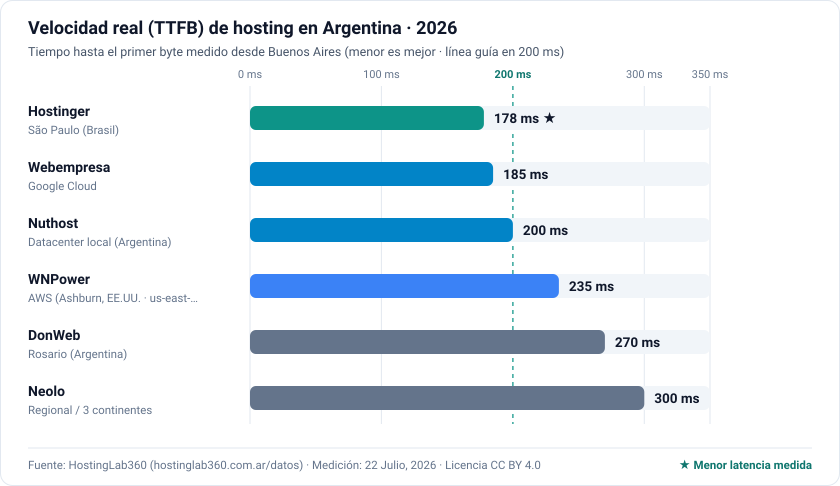
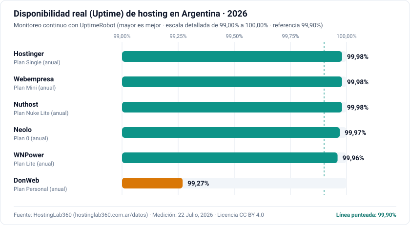

# 🧪 HostingLab360 - Recursos Técnicos y Dataset Abierto

Documentación pública, gráficos reutilizables y datos abiertos de **[HostingLab360](https://hostinglab360.com.ar)**, laboratorio técnico independiente que audita servicios de alojamiento web en Argentina. Este repositorio conserva el dataset abierto de mediciones, guías técnicas, criterios de análisis y ejemplos educativos; los análisis completos vigentes se publican en el sitio principal.

[](https://hostinglab360.com.ar)
[](https://hostinglab360.com.ar/datos)
[](https://hostinglab360.com.ar/verificar)
[](LICENSE)

---

## 📊 Dataset Abierto de Rendimiento 2026 (CC BY 4.0)

Publicamos las mediciones consolidadas de latencia (`TTFB`), disponibilidad (`Uptime`), ubicación real del servidor y condiciones comerciales en formato abierto para periodistas, desarrolladores, agencias, investigadores y sistemas de IA:

- 🌐 **Página oficial de Datos Abiertos (fuente canónica)**: [https://hostinglab360.com.ar/datos](https://hostinglab360.com.ar/datos)
- 📄 **Dataset JSON**: [Versión en vivo](https://hostinglab360.com.ar/data/hosting-stats-2026.json) | [Copia en este repositorio](dataset/hosting-stats-2026.json)
- 📈 **Dataset CSV**: [Versión en vivo](https://hostinglab360.com.ar/data/hosting-stats-2026.csv) | [Copia en este repositorio](dataset/hosting-stats-2026.csv)
- 🤖 **Documentación estructurada para LLMs**: [llms.txt](https://hostinglab360.com.ar/llms.txt) | [llms-full.txt](https://hostinglab360.com.ar/llms-full.txt) | [ai.txt](https://hostinglab360.com.ar/ai.txt)

### Resumen de auditorías (última auditoría: 22 jul 2026 · precios revisados: 23 nov 2026)

| Proveedor | TTFB medido | Uptime | Plan auditado | Precio de referencia | Nodo / Infraestructura | Auditado |
|---|---:|---:|---|---|---|---|
| [WNPower](https://hostinglab360.com.ar/reviews/wnpower) | 235 ms | 99,96 % | Plan Lite (anual) | ARS 2.530/mes | AWS (Ashburn, EE.UU. · us-east-1) | 22 jul 2026 |
| [Hostinger](https://hostinglab360.com.ar/reviews/hostinger) | 178 ms | 99,98 % | Plan Single (anual) | ARS 4.899/mes | São Paulo (Brasil) | 22 jul 2026 |
| [Neolo](https://hostinglab360.com.ar/reviews/neolo) | 300 ms | 99,97 % | Plan 0 (anual) | ARS 3.396/mes | Regional / 3 continentes | 22 jul 2026 |
| [Webempresa](https://hostinglab360.com.ar/reviews/webempresa) | 185 ms | 99,98 % | Plan Mini (anual) | USD 1,18/mes | Google Cloud | 22 jul 2026 |
| [DonWeb](https://hostinglab360.com.ar/reviews/donweb) | 270 ms | 99,27 % | Plan Personal (anual) | ARS 3.800/mes | Rosario (Argentina) | 22 jul 2026 |
| [Nuthost](https://hostinglab360.com.ar/reviews/nuthost) | 200 ms | 99,98 % | Plan Nuke Lite (anual) | ARS 3.600/mes | Datacenter local (Argentina) | 22 jul 2026 |

> *Auditorías técnicas ejecutadas en ciclo rotativo desde Buenos Aires sobre planes iniciales contratados de forma anónima. Cada proveedor muestra su fecha individual de auditoría; los precios se revisan periódicamente en bloque y corresponden a contratación anual.*

### Gráficos reutilizables (CC BY 4.0)

Podés descargar e incrustar estos gráficos libremente en artículos, informes, presentaciones o redes sociales citando a **HostingLab360**:





---

## 📌 Cómo citar estos datos

Este repositorio incluye [`CITATION.cff`](CITATION.cff) (podés usar el botón **"Cite this repository"** en la barra lateral de GitHub) o copiar cualquiera de estos formatos:

**Texto plano:**
```text
Fuente: HostingLab360 — Datos abiertos de rendimiento de hosting en Argentina (2026). Medición: 22 jul 2026. Licencia CC BY 4.0. Disponible en: https://hostinglab360.com.ar/datos
```

**HTML listo para artículos y blogs:**
```html
<p>Fuente: <a href="https://hostinglab360.com.ar/datos" rel="noopener">HostingLab360 — Datos abiertos de hosting en Argentina (2026)</a> (CC BY 4.0).</p>
```

**Markdown:**
```markdown
Fuente: [HostingLab360 — Datos abiertos de hosting en Argentina (2026)](https://hostinglab360.com.ar/datos) (CC BY 4.0).
```

---

## ⚠️ Alcance de este Repositorio

> **Importante**
>
> Los scripts publicados en `/scripts-demo` son **ejemplos históricos, básicos y educativos**. No son el stack de pruebas que HostingLab360 utiliza actualmente.
>
> **No permiten reproducir exactamente** nuestras reviews, rankings ni mediciones actuales. La metodología vigente y los resultados publicados están en el sitio principal.
>
> Conservamos este material por valor educativo y transparencia histórica, no como especificación del protocolo actual del laboratorio.

📖 **Para más detalles**: Ver [ALCANCE.md](ALCANCE.md) | 🔬 **Reproducibilidad**: Ver [REPRODUCIBILIDAD.md](REPRODUCIBILIDAD.md)

---

## 📂 Contenido del Repositorio

### `/dataset` - Datos Abiertos de Auditoría
- [hosting-stats-2026.json](dataset/hosting-stats-2026.json) — Métricas estructuradas en JSON (incluye renovación, plan y nodo)
- [hosting-stats-2026.csv](dataset/hosting-stats-2026.csv) — Tabla de métricas en CSV lista para Excel / Python / R

### `/charts` - Gráficos Vectoriales Reutilizables (SVG)
- [ttfb-argentina-2026.svg](charts/ttfb-argentina-2026.svg) — Latencia TTFB medida desde Buenos Aires
- [uptime-argentina-2026.svg](charts/uptime-argentina-2026.svg) — Disponibilidad medida con UptimeRobot

### `/guides` - Guías Técnicas
- [Cómo evaluar un hosting web](guides/como-evaluar-hosting.md)
- [Métricas de rendimiento: TTFB y Core Web Vitals](guides/metricas-rendimiento.md)
- [Hosting compartido vs VPS: guía técnica](guides/hosting-compartido-vs-vps.md)
- [Checklist: migrar tu sitio a otro hosting](guides/checklist-migracion.md)

### `/scripts-demo` - Ejemplos Históricos Básicos
- [Test de TTFB simple](scripts-demo/test-ttfb.sh) — Mide Time To First Byte
- [Monitor de uptime básico](scripts-demo/monitor-uptime.sh) — Verifica disponibilidad
- [Benchmark de velocidad PHP](scripts-demo/benchmark-php.php) — Prueba rendimiento PHP

> **Importante**: son demostraciones desactualizadas. No representan la infraestructura, frecuencia de medición, controles ni herramientas que utiliza actualmente HostingLab360.

### `/metodologia-publica` - Archivo Metodológico
- [Cómo probamos los hostings](metodologia-publica/proceso-analisis.md)
- [Criterios de evaluación y scoring](metodologia-publica/criterios-ranking.md)

> **Nota**: este material se conserva como archivo educativo. Para conocer el protocolo vigente, consultá la página oficial de [Metodología](https://hostinglab360.com.ar/metodologia).

---

## 🔗 Referencia y Auditorías Completas en HostingLab360

### Secciones Principales
- 🏠 [Portada y Ranking General](https://hostinglab360.com.ar)
- 📊 [Datos Abiertos del Laboratorio](https://hostinglab360.com.ar/datos)
- 🏅 [Sello de Auditoría y Premios](https://hostinglab360.com.ar/sello)
- ✅ [Verificación Pública de Certificados](https://hostinglab360.com.ar/verificar)
- 🔬 [Metodología y Protocolo de Pruebas](https://hostinglab360.com.ar/metodologia)
- ⭐ [Índice de Reviews de Proveedores](https://hostinglab360.com.ar/reviews)
- ⚔️ [Índice de Comparativas Directas](https://hostinglab360.com.ar/comparativas)
- 📖 [Centro de Guías Técnicas](https://hostinglab360.com.ar/guias)
- 👤 [Sobre Nosotros](https://hostinglab360.com.ar/nosotros) · [Perfil Técnico: Rafael Scotti](https://hostinglab360.com.ar/autor/rafael-scotti)

### Auditorías Individuales por Proveedor
- [Análisis y Opinión de WNPower Argentina](https://hostinglab360.com.ar/reviews/wnpower)
- [Análisis y Opinión de Hostinger Argentina](https://hostinglab360.com.ar/reviews/hostinger)
- [Análisis y Opinión de Neolo Argentina](https://hostinglab360.com.ar/reviews/neolo)
- [Análisis y Opinión de Webempresa Argentina](https://hostinglab360.com.ar/reviews/webempresa)
- [Análisis y Opinión de DonWeb Argentina](https://hostinglab360.com.ar/reviews/donweb)
- [Análisis y Opinión de Nuthost Argentina](https://hostinglab360.com.ar/reviews/nuthost)

### Comparativas Técnicas Mano a Mano
- [Hostinger vs WNPower](https://hostinglab360.com.ar/comparativas/hostinger-vs-wnpower)
- [Neolo vs WNPower](https://hostinglab360.com.ar/comparativas/neolo-vs-wnpower)
- [Webempresa vs WNPower](https://hostinglab360.com.ar/comparativas/webempresa-vs-wnpower)
- [DonWeb vs WNPower](https://hostinglab360.com.ar/comparativas/donweb-vs-wnpower)
- [Nuthost vs WNPower](https://hostinglab360.com.ar/comparativas/nuthost-vs-wnpower)
- [Hostinger vs Neolo](https://hostinglab360.com.ar/comparativas/hostinger-vs-neolo)

### Guías de Arquitectura y Optimización
- [Guía para elegir hosting en Argentina (2026)](https://hostinglab360.com.ar/guias/guia-elegir-hosting-argentina-2026)
- [Hosting para WordPress en Argentina: pruebas y configuración](https://hostinglab360.com.ar/guias/wordpress-hosting-argentina-2026)
- [VPS vs Hosting Compartido: comparativa de arquitectura](https://hostinglab360.com.ar/guias/vps-vs-hosting-compartido-2026)
- [10 formas de acelerar un sitio web en 2026](https://hostinglab360.com.ar/guias/10-formas-acelerar-sitio-web-2026)

---

## 📄 Licencia

- **Código y scripts de ejemplo**: MIT License — Ver [LICENSE](LICENSE).
- **Dataset (`/dataset`) y gráficos (`/charts`)**: Creative Commons Attribution 4.0 International (`CC BY 4.0`) atribuido a [HostingLab360](https://hostinglab360.com.ar).

---

**HostingLab360** — Laboratorio independiente de hosting web en Argentina  
🌐 [hostinglab360.com.ar](https://hostinglab360.com.ar) | 🐙 GitHub: [@hostinglab360](https://github.com/hostinglab360)
